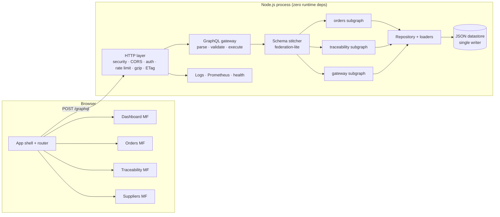

# Architecture

> Visual companion: [DIAGRAMS.md](DIAGRAMS.md) contains the data-flow, ER, UML class, sequence, component, deployment, and C4 views generated from this implementation.

## 1. Shape of the system



The browser is a **shell + four microfrontends**, all plain JavaScript modules with a shared contract. The server is one Node process: an HTTP edge, a hand-written GraphQL engine, a composed schema, domain services, and a JSON store.

---

## 2. Request lifecycle

1. `server.js` loads configuration, initialises `JsonStore` (seeding on first boot), creates the repository, and builds the stitched schema **once** at boot.
2. `node:http` accepts the request. `src/http/app.js` assigns a request ID, security headers, and starts timing.
3. CORS is checked before routing. Health, readiness, metrics, schema, and static files have dedicated handlers.
4. `/graphql`:
   - rate limit keyed by client IP (honours `X-Forwarded-For` only when `TRUST_PROXY` is set)
   - constant-time bearer-token check when `API_TOKEN` is configured
   - `Content-Type` and body-size enforcement
   - parse → depth/field-count guard → validate → read-only guard
   - execute with a per-request context: `{ repo, loaders, config, logger, requestId, ip }`
5. Resolvers read through the repository. Loaders memoise entity lookups for the request so nested order → supplier → product paths do not repeatedly scan arrays.
6. The response is JSON (GraphQL errors keep HTTP 200; malformed HTTP requests use 4xx). `extensions.requestId` and `durationMs` are attached.
7. The `finish` listener records status, route, duration, and increments Prometheus counters.

Mutations are executed **serially** by the GraphQL executor; queries execute fields concurrently (promises) while the underlying repository remains synchronous.

---

## 3. Schema stitching

Three subgraphs are declared independently:

| Subgraph | Owns |
| --- | --- |
| `orders` | `Query` order/product/supplier/facility/shipment/metrics fields, `Mutation` create/update, order and logistics types |
| `traceability` | `extend type Query` and `extend type Mutation`, trace record/event types, extends `PurchaseOrder` with `traceability`, `chainVerified`, `traceabilitySummary` |
| `gateway` | `gatewayInfo` and introspection of the composition itself |

`src/gateway/stitch.js`:

1. Parses each SDL document with the same parser used for executable queries.
2. Concatenates definitions and calls `buildSchema(..., { mergeTypes: true })`.
3. Duplicate object/input fields are allowed only when their type signatures are identical; conflicting definitions fail at boot.
4. Resolver maps are merged. A field may have exactly one resolver owner; collisions throw with both subgraph names.
5. Root fields without a resolver are rejected.
6. A stitch report (`subgraphs`, type/resolver counts, merge timestamp) is attached to the schema and exposed through `gatewayInfo` and `/graphql/schema.json`.

Cross-subgraph references are **resolver-driven**, not a full entity-federation runtime. A traceability record hands `{ id }` to the `Product` field resolvers owned by the orders subgraph, which read the rest from the repository. This is enough for a gateway over shared domain data and avoids a query planner.

---

## 4. GraphQL engine

The engine under `src/graphql/` is a deliberately scoped implementation:

| Stage | File | Notes |
| --- | --- | --- |
| Lexing | `lexer.js` | names, numbers, strings, block-string dedent, comments, positions |
| Parsing | `parser.js` | executable documents + SDL (objects, inputs, enums, scalars, directives, extensions) |
| Schema | `schema.js` | type registry, field/argument validation, built-in scalars and directives, SDL/JSON printing |
| Validation | `validate.js` | field/argument/types, variables and positions, fragments/cycles, directives, suggestions |
| Execution | `execute.js` | variables, literals, directives, fragments, lists, non-null bubbling, error paths |

Built-in scalars include `DateTime`; built-in directives include `@include`, `@skip`, `@deprecated`, `@specifiedBy`, and `@key` (used by the stitcher). The runtime supports objects, inputs, enums, scalars, lists, and non-null wrappers. Interfaces, unions, subscriptions, and introspection are intentionally unsupported; `/graphql/schema.graphql` and `/graphql/schema.json` fill the tooling gap.

### Error semantics

- Resolver errors that are already `GraphQLError` keep their message and code.
- Unexpected errors are logged with stack traces; production responses are replaced with `Internal server error`.
- Non-null fields bubble to the nearest nullable parent, preserving the original path and locations.
- Variable coercion failures use `BAD_USER_INPUT`; validation failures use `GRAPHQL_VALIDATION_FAILED`.

### Complexity guard

Before validation, the HTTP layer walks the selected fields (following fragments with cycle protection) and rejects queries over `MAX_QUERY_DEPTH` or `MAX_QUERY_FIELDS`. Query strings are capped at 60 KB and bodies at `BODY_LIMIT_BYTES`. This is a coarse guard, not a full cost model.

---

## 5. Data model

```text
Supplier 1 ─── * Product
Supplier 1 ─── * PurchaseOrder
PurchaseOrder 1 ─── * OrderLine ─── 1 Product
PurchaseOrder 1 ─── * Shipment ─── * ShipmentMilestone
PurchaseOrder 1 ─── * TraceabilityRecord ─── * TraceEvent
TraceabilityRecord ─── Product, Supplier, Facility path
Shipment ─── origin/destination Facility
```

Key invariants enforced by the repository:

- Order totals are recomputed from lines; client-supplied totals are ignored.
- An order line's product must belong to the order's supplier.
- Quantities are positive integers; unit prices are finite and bounded.
- Status changes follow a state machine (`DRAFT → PENDING_CONFIRMATION → CONFIRMED → IN_PRODUCTION → …`). Terminal states cannot transition.
- Delivering an order marks lines received and shipments delivered.
- Trace events must use a known type, a known facility, and a non-decreasing timestamp.

Risk scoring is intentionally explainable: supplier risk base + priority + reliability penalty + shipment delay + days late + missing evidence + on-hold penalty, capped at 100. Factors are returned to the UI so operators can see *why* an order is flagged. Terminal orders carry zero active risk.

---

## 6. Tamper-evident traceability

Each `TraceEvent` contains `previousHash` and `integrityHash`. The hash covers:

```text
SHA-256(previousHash + "\n" + canonicalJSON({
  id, recordId, sequence, type, occurredAt,
  facilityId, actor, notes, documentRefs
}))
```

`canonicalize()` sorts object keys recursively. `verifyRecordChain()`:

1. sorts by sequence and checks 1..N continuity,
2. checks `previousHash` linkage,
3. recomputes every digest,
4. returns the first broken event, expected hash, actual hash, and a human-readable reason.

Seed data deliberately corrupts one record's third event so the dashboard shows a real exception and the detail page can point at the exact event. Appending an event extends the chain; if the chain is already broken, verification continues to fail at the original break.

This proves **internal consistency** and detects edits to the datastore or API path. It is not a public blockchain and does not protect against an attacker who can rewrite every hash from genesis; pair it with immutable storage/WORM or signed anchors if that threat matters.

---

## 7. Microfrontend contract

Manifest: `public/js/microfrontends/manifest.json`

```json
{
  "version": "1.0.0",
  "microfrontends": [
    { "name": "orders", "route": "/orders", "entry": "/js/microfrontends/orders.js" }
  ]
}
```

A module exports:

```js
export const meta = { name, title, route };
export async function mount(root, ctx) {
  // render into root, attach listeners
  return () => { /* cleanup: abort fetches, remove listeners */ };
}
```

`ctx` provides `route`, `gql`, `auth`, `navigate`, `refresh`, `announce`, `showToast`, `setTitle`, `setLastUpdated`, and `focusHeading`. The loader:

- fetches the manifest `no-store` and validates entries,
- matches the longest route prefix,
- imports the module once (version query from the manifest),
- runs the previous cleanup,
- catches import/mount failures with an error boundary and retry,
- moves focus to the new `h1` and announces the page.

Microfrontends are independent modules but share `public/js/ui.js`, `format.js`, and `html.js`; there is no framework and no build step for JavaScript.

### Why microfrontends here?

The original project refactored microfrontend modules to vanilla JavaScript for restrictive networks. This implementation keeps that boundary: each view can be cached, loaded, and reasoned about independently, while the shell owns navigation, auth, and error containment. A manifest keeps deployment of a module independent from the shell.

---

## 8. HTTP and security layers

- **Headers:** CSP without inline script/style, `nosniff`, frame denial, referrer policy, permissions policy, COOP/CORP, HSTS opt-in.
- **Static:** path resolution constrained to `public/`, MIME allow-list, ETag revalidation, `no-cache` for app assets so deploys take effect immediately, gzip for compressible bodies.
- **CORS:** same-origin by default; explicit `ALLOWED_ORIGINS` for split deployments; preflight `204`.
- **Auth:** optional shared bearer token; constant-time compare; no cookies means no ambient CSRF credential.
- **Rate limits:** fixed window per IP, `RateLimit-*` headers, `429` + `Retry-After`.
- **Logging:** structured JSON; tokens and bodies are never logged.

See [SECURITY.md](SECURITY.md) for threats and residual risks.

---

## 9. Performance notes

- The dataset is small (52 orders, ~38 lots), so filtering and metrics are computed in memory in microseconds.
- Per-request loaders remove repeated linear scans in nested resolvers.
- GraphQL depth/field limits prevent pathological selections.
- Static assets are cached in memory by mtime/size, gzipped, and ETagged.
- The chart is hand-drawn SVG with no chart library; Tailwind CSS is a single 54 KB minified file (~8 KB gzipped).
- The seed data, GraphQL responses, and UI do not require external network requests, fonts, or CDNs — suitable for restrictive networks.

If the dataset grows, the first bottleneck is the single JSON file and full scans. Move to an indexed database before adding nodes.

---

## 10. Failure modes and recovery

| Failure | Behaviour |
| --- | --- |
| Datastore missing | Seed on first boot (`SEED_ON_START=true`), then serve |
| Datastore corrupt | Quarantine `.corrupt-<timestamp>`, reseed, log `store.quarantined` |
| Write failure | Mutation fails; in-memory state is not published |
| Resolver exception | Logged; production response is generic; non-null errors bubble |
| Microfrontend import failure | Error boundary with retry; shell and other views stay healthy |
| API offline | Header status dot turns red; views show retry states |
| Process termination | SIGTERM/SIGINT drain the server, await the write queue, exit cleanly |

---

## 11. Extension points

- **Database:** implement the repository methods against Postgres; keep resolvers unchanged.
- **Identity:** replace the shared token check with JWT/OIDC claims and add field-level authorization.
- **New subgraph:** add SDL + resolver map and include it in `src/gateway/index.js`; collisions fail fast.
- **ERPs:** add connectors that write through repository commands; keep GraphQL as the read model.
- **Subscriptions:** add SSE at the HTTP layer and a change feed from the store/DB.
- **Language/region:** add `locale` context and `Intl` formatting per request; the UI already uses `Intl`.
