# System Diagrams

Editable Mermaid sources live in [`docs/diagrams/src/`](docs/diagrams/src/); rendered PNGs live in [`docs/diagrams/`](docs/diagrams/). Every diagram describes the running implementation in this repository (version 1.0.0), not an aspirational architecture.

| # | View | Rendered | Source |
| --- | --- | --- | --- |
| 1 | Data Flow — context | [dfd-context.png](docs/diagrams/dfd-context.png) | [dfd-context.mmd](docs/diagrams/src/dfd-context.mmd) |
| 1 | Data Flow — Level 1 | [dfd-level1.png](docs/diagrams/dfd-level1.png) | [dfd-level1.mmd](docs/diagrams/src/dfd-level1.mmd) |
| 2 | Entity Relationship | [erd.png](docs/diagrams/erd.png) | [erd.mmd](docs/diagrams/src/erd.mmd) |
| 3 | UML Class — domain | [uml-class-domain.png](docs/diagrams/uml-class-domain.png) | [uml-class-domain.mmd](docs/diagrams/src/uml-class-domain.mmd) |
| 3 | UML Class — application | [uml-class-application.png](docs/diagrams/uml-class-application.png) | [uml-class-application.mmd](docs/diagrams/src/uml-class-application.mmd) |
| 4 | Sequence — order detail query | [sequence-order-query.png](docs/diagrams/sequence-order-query.png) | [sequence-order-query.mmd](docs/diagrams/src/sequence-order-query.mmd) |
| 4 | Sequence — append custody event | [sequence-append-event.png](docs/diagrams/sequence-append-event.png) | [sequence-append-event.mmd](docs/diagrams/src/sequence-append-event.mmd) |
| 5 | Component | [component.png](docs/diagrams/component.png) | [component.mmd](docs/diagrams/src/component.mmd) |
| 6 | Deployment | [deployment.png](docs/diagrams/deployment.png) | [deployment.mmd](docs/diagrams/src/deployment.mmd) |
| 7 | C4 — System Context | [c4-context.png](docs/diagrams/c4-context.png) | [c4-context.mmd](docs/diagrams/src/c4-context.mmd) |
| 7 | C4 — Container | [c4-container.png](docs/diagrams/c4-container.png) | [c4-container.mmd](docs/diagrams/src/c4-container.mmd) |
| 7 | C4 — Component (Level 3) | [c4-component.png](docs/diagrams/c4-component.png) | [c4-component.mmd](docs/diagrams/src/c4-component.mmd) |

---

## 1. Data Flow Diagrams

### 1.1 Context (Level 0)

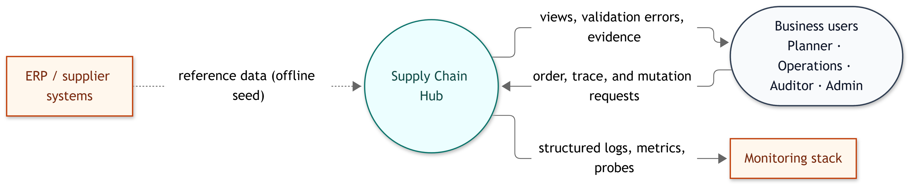

The hub is the single processing boundary. Business users send queries and mutations; the hub returns views, validation errors, and evidence. ERP/supplier data is imported offline by the seed in this build. Monitoring receives logs, metrics, and probe results.

### 1.2 Level 1

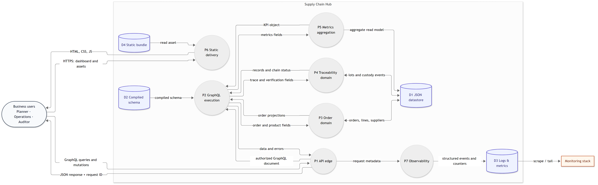

| Element | Description |
| --- | --- |
| **P1 API edge** | CORS, headers, optional bearer token, rate limit, body/query limits, parsing, validation |
| **P2 GraphQL execution** | Field collection, resolver dispatch, non-null propagation, stitch-owned field resolution |
| **P3 Order domain** | Orders, lines, suppliers, products, shipments, state machine, risk |
| **P4 Traceability domain** | Lot records, custody events, hash-chain verification, append mutation |
| **P5 Metrics aggregation** | KPIs, spend trend, risk distribution, chain integrity |
| **P6 Static delivery** | Shell, compiled CSS, JS modules, manifest, 404 page |
| **P7 Observability** | Request logs, GraphQL counters, health/readiness, metrics endpoint |
| **D1 JSON datastore** | `supply-chain.json`, copy-on-write mutations, atomic rename |
| **D2 Compiled schema** | In-memory stitched schema built at boot |
| **D3 Logs & metrics** | stdout/stderr JSON lines and in-process Prometheus counters |
| **D4 Static bundle** | `public/` assets served from the image |

The diagram intentionally omits the **boot-time seed/reset** path; it is documented in [ARCHITECTURE.md](ARCHITECTURE.md#5-data-model) and [DEPLOYMENT.md](DEPLOYMENT.md#6-persistence-backup-and-restore). It also omits the optional reverse proxy and OIDC layer, which are deployment concerns shown in the deployment diagram.

---

## 2. Entity Relationship Diagram

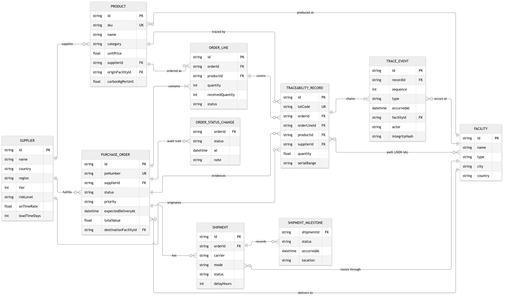

| Relationship | Cardinality | Notes |
| --- | --- | --- |
| Supplier → Product | 1 : 0..* | A product has exactly one supplier |
| Supplier → PurchaseOrder | 1 : 0..* | Orders are awarded to one supplier |
| PurchaseOrder → OrderLine | 1 : 1..* | At least one line is required |
| Product → OrderLine | 1 : 0..* | A line references one product |
| PurchaseOrder → Shipment | 1 : 0..* | One shipment is created for shipped/delivered orders in the seed |
| PurchaseOrder → Facility | * : 1 | `destinationFacilityId`; the delivery destination |
| Shipment → ShipmentMilestone | 1 : 0..* | Milestones are embedded, ordered by `occurredAt` |
| PurchaseOrder → TraceabilityRecord | 1 : 0..* | A lot record evidences an order |
| TraceabilityRecord → TraceEvent | 1 : 1..* | Events form the hash chain |
| TraceEvent → Facility | * : 1 | Each event occurs at one facility |
| TraceabilityRecord ↔ Facility | * : * | Logical path; stored as `facilityIdsJson` |

Important implementation details:

- `shipmentIdsJson`, `facilityIdsJson`, `certificateRefsJson`, `documentRefsJson`, and `statusHistory` are **embedded JSON arrays**, not join tables or child rows. The ERD suffix `Json` marks the cardinality role for readability; the actual datastore keys are `shipmentIds`, `facilityIds`, `certificateRefs`, and `documentRefs`.
- `ShipmentMilestone` and `OrderStatusChange` are weak/embedded records without their own top-level ID in the datastore.
- `PurchaseOrder.totalValue` is a stored, denormalized sum of its lines.
- `riskScore`, `riskLevel`, `daysUntilDue`, and `lineTotal` are **computed at read time** and therefore not columns.
- The single-file JSON store preserves these shapes; a relational adapter would normalize the JSON arrays.

---

## 3. UML Class Diagrams

### 3.1 Domain model

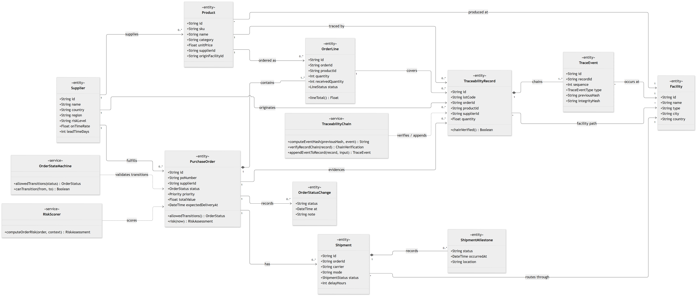

### 3.2 Application services

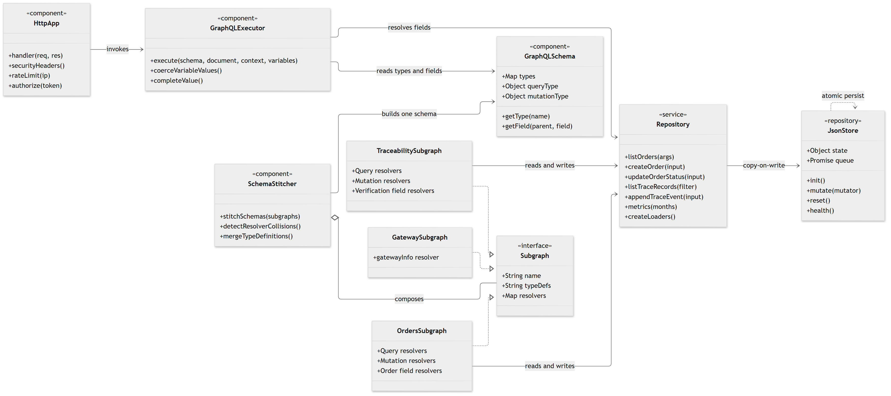

The code is JavaScript: domain entities are plain objects, services are modules/factory functions, and `JsonStore` is the main class. The UML stereotypes (`<<entity>>`, `<<service>>`, `<<component>>`, `<<interface>>`, `<<repository>>`) map those modules to familiar responsibilities.

- `PurchaseOrder` collaborates with `OrderStateMachine` for legal transitions and `RiskScorer` for explainable risk.
- `TraceabilityChain` owns the SHA-256 link, verification, and append behavior.
- `GraphQLExecutor` reads `GraphQLSchema`, delegates root fields to subgraph resolvers, and resolves through `Repository`.
- `SchemaStitcher` composes the three `Subgraph` implementations into a single schema at boot.
- `Repository` is the persistence seam: replacing `JsonStore` with a database keeps resolvers unchanged.

---

## 4. Sequence Diagrams

### 4.1 Order detail query

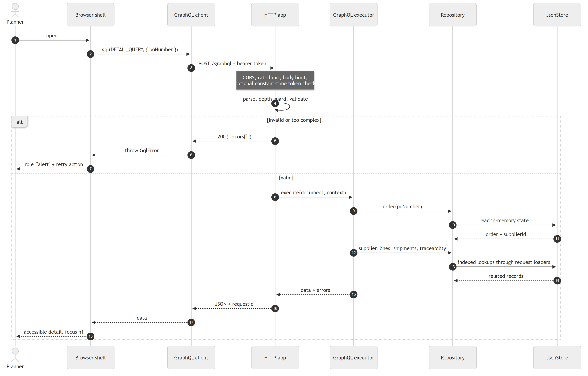

The diagram includes the failure branch: parse/depth/validation errors return a GraphQL `errors` array, which the client converts to a `GqlError` and the shell renders as a `role="alert"` state with a retry action.

### 4.2 Append custody event

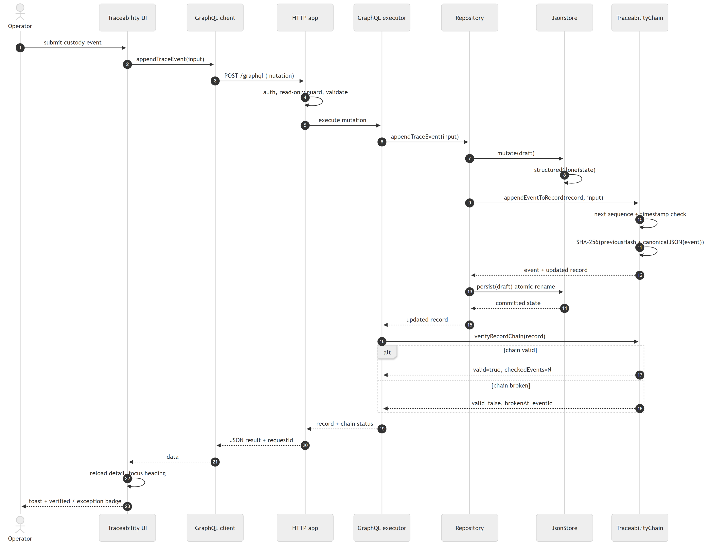

This is the write path that exercises the integrity model:

1. HTTP edge authenticates, applies the read-only guard, and validates the mutation.
2. The repository clones the datastore before mutating.
3. `TraceabilityChain` selects the next sequence, enforces the timestamp ordering, and computes `SHA-256(previousHash + canonicalJSON(event))`.
4. The draft is persisted atomically; only then is the new state published in memory.
5. Verification recomputes the chain and returns either `valid=true` or the exact `brokenAt` event.

---

## 5. Component Diagram

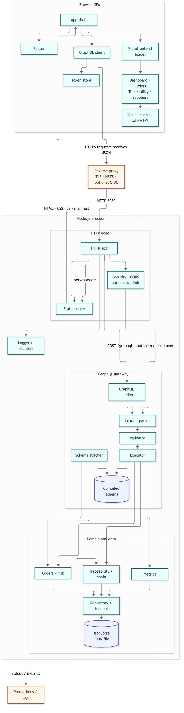

The system has two runtime tiers:

- **Browser SPA** — app shell, router, GraphQL client, token store, manifest-driven microfrontend loader, four view modules, shared UI/chart helpers.
- **Node.js process** — HTTP edge (security, CORS, auth, rate limit, static server), GraphQL handler (parser, validator, executor, schema stitcher), domain modules (orders/risk, traceability/hash chain, metrics), repository/loaders, JSON store, and observability.

The interface between tiers is JSON over `POST /graphql`; static delivery is `GET /` and `/assets/*`.

---

## 6. Deployment Diagram

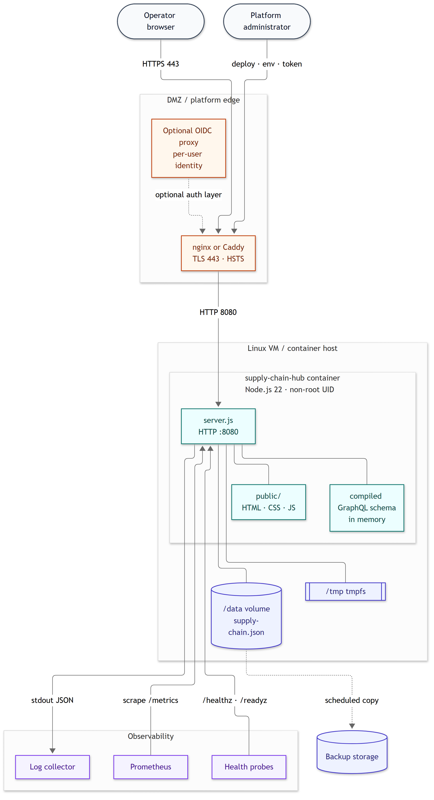

| Node | Responsibility |
| --- | --- |
| Operator browser | Runs the SPA; no server-side session |
| DMZ reverse proxy | TLS 443, HSTS, optional OIDC proxy, forwards to `127.0.0.1:8080` |
| Linux VM / container host | Runs the Node 22 process as a non-root UID |
| `supply-chain-hub` container | `server.js`, `public/`, compiled schema in memory |
| `/data` volume | Persistent `supply-chain.json`; the only writable application path |
| `/tmp` tmpfs | Ephemeral OS temp; not application state |
| Prometheus / log collector / probes | Scrape `/metrics`, collect stdout JSON, poll `/healthz` and `/readyz` |
| Backup storage | Scheduled copy of the datastore volume |

The container is designed to run read-only except `/data` and `/tmp`, with `no-new-privileges` and all capabilities dropped. See [DEPLOYMENT.md](DEPLOYMENT.md#2-docker-recommended).

---

## 7. C4 Model

### 7.1 System Context

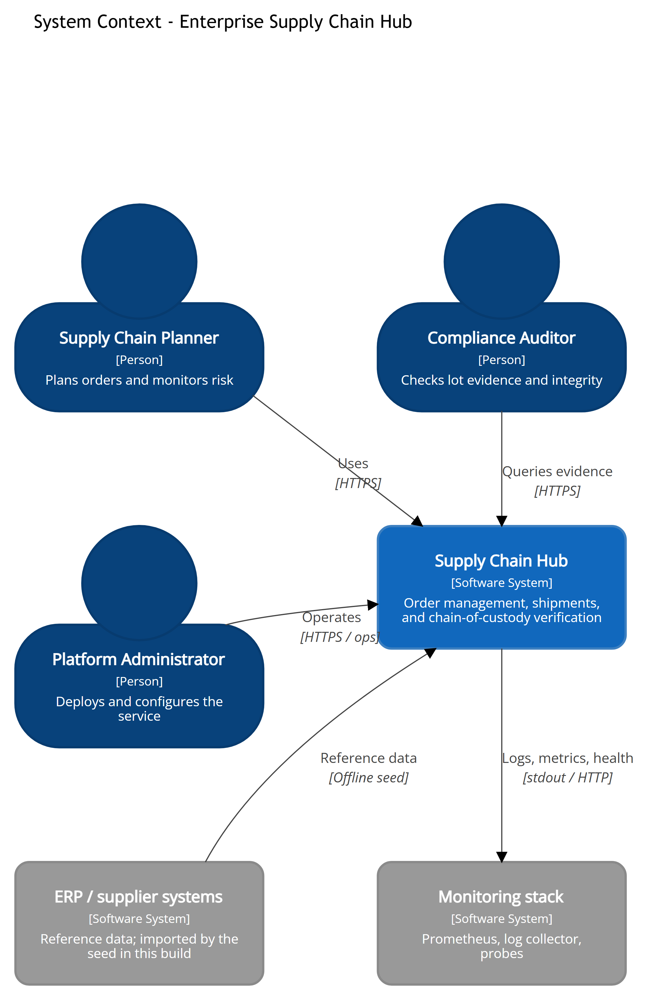

Actors: Supply Chain Planner, Compliance Auditor, Platform Administrator. External systems: ERP/supplier reference data (offline seed in this build), monitoring. The system boundary is the hub; the reverse proxy is intentionally left to the deployment diagram.

### 7.2 Container

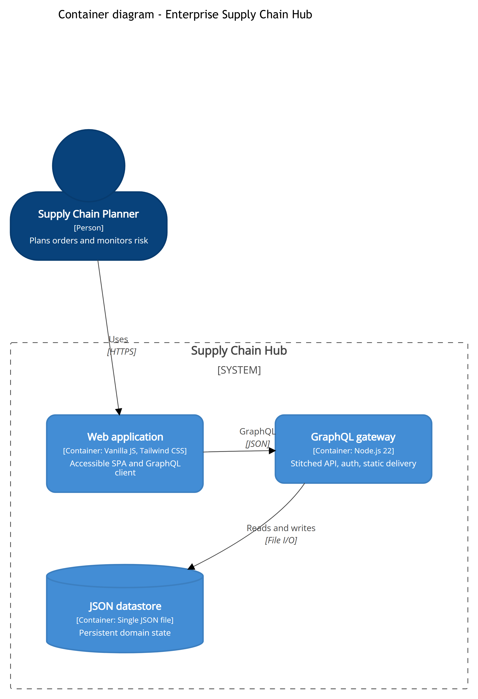

Three containers: web application, GraphQL gateway, JSON datastore. The browser and API communicate with GraphQL/JSON over HTTPS; the API reads and writes the datastore with file I/O.

### 7.3 Component (Level 3)

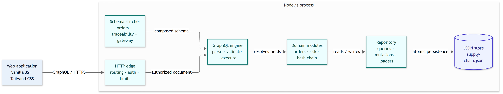

This Level 3 view is drawn as a simplified C4-style flowchart: HTTP edge, GraphQL engine, schema stitcher, domain modules, repository, and JSON store. A simplified flowchart is used instead of Mermaid's `C4Component` renderer because the official renderer overlaps labels for this component count; the abstraction and relationships are C4 components.

C4 Deployment is represented by the [deployment diagram](#6-deployment-diagram), which adds the host, proxy, volume, and observability nodes.

---

## Notation and assumptions

- **DFD** uses circles for processes, cylinders for data stores, and rounded/rectangular nodes for external entities. Numbered processes (`P1`–`P7`) and stores (`D1`–`D4`) make the narrative traceable.
- **ERD** uses crow's-foot cardinality, `PK` primary key, `FK` foreign key, and `UK` unique key. Embedded JSON arrays are called out explicitly.
- **UML class** uses `<<entity>>`, `<<service>>`, `<<component>>`, `<<interface>>`, and `<<repository>>` stereotypes because the implementation uses modules rather than classes for most services.
- **Sequence** lifelines map to actual modules (`HTTP app`, `GraphQL executor`, `Repository`, `JsonStore`, `TraceabilityChain`).
- **C4** uses Mermaid `C4Context` and `C4Container` for Levels 1–2; Level 3 is a simplified component flowchart as noted above.
- All diagrams are generated from the source and reflect the seed/API shapes in `src/` and `public/`.

## Regenerating the images

The sources are plain Mermaid. Install Mermaid CLI (it brings a headless browser) or use an existing Chrome installation:

```bash
npm install --no-save @mermaid-js/mermaid-cli
npx mmdc \
  -i docs/diagrams/src/erd.mmd \
  -o docs/diagrams/erd.png \
  -p docs/diagrams/puppeteer.example.json \
  -t neutral -b white -s 2 --size 2200
```

`puppeteer.example.json` contains the Chrome arguments; if Puppeteer cannot find a browser, add an `executablePath` or set `PUPPETEER_EXECUTABLE_PATH`:

```powershell
$env:PUPPETEER_EXECUTABLE_PATH="C:\Program Files\Google\Chrome\Application\chrome.exe"
```

Regenerate every diagram:

```bash
for f in docs/diagrams/src/*.mmd; do
  npx mmdc -i "$f" -o "docs/diagrams/$(basename "${f%.mmd}").png" \
    -p docs/diagrams/puppeteer.example.json -t neutral -b white -s 2 --size 2200
done
```

The PNGs are committed so the application has no diagram or browser dependency at runtime.
