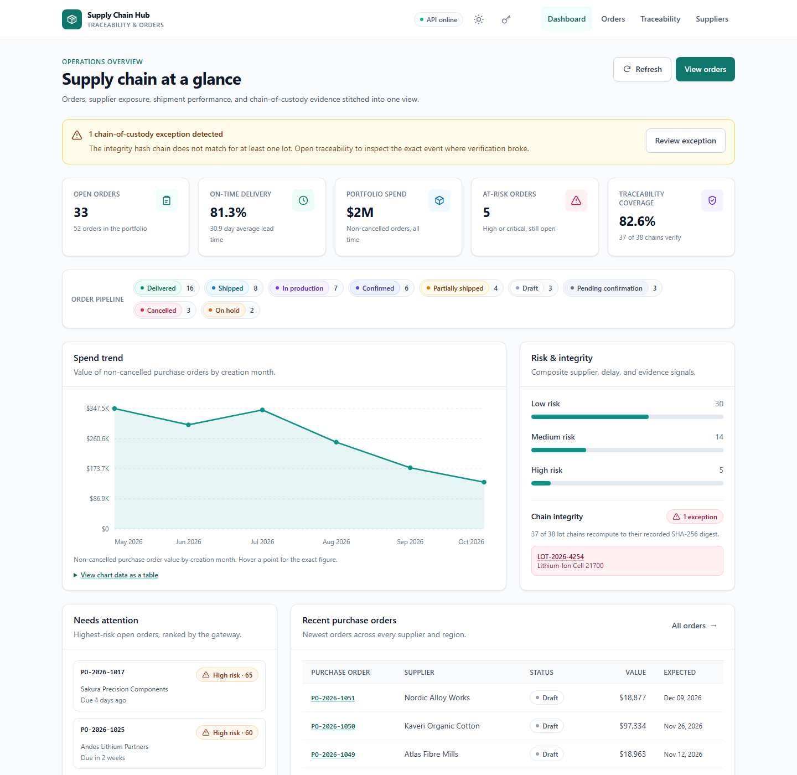

# Enterprise Supply Chain Traceability & Order Management Hub

A production-shaped, full-stack supply chain application built with **JavaScript, Node.js, GraphQL, and Tailwind CSS**. It stitches purchase orders, supplier risk, shipments, and product chain-of-custody data into a single GraphQL gateway and an accessible vanilla-JavaScript dashboard.

The runtime has **zero npm dependencies**. Tailwind is used only at build time; the compiled stylesheet is committed, so the app starts with `node server.js` on a clean machine.



---

## What it does

| Capability | Implementation |
| --- | --- |
| Purchase order management | Search, filter, sort, cursor-paginate 52 seeded POs; create draft orders; enforce a server-side status state machine |
| Supplier portfolio | Risk level, on-time rate, lead time, certifications, active commitments, product catalog |
| Shipments | Carrier, mode, ETA, delay hours, temperature control, milestone timeline |
| Product traceability | Lot codes, serial ranges, facility path, certificate references, custody events |
| Tamper-evident chain | SHA-256 hash chain per lot, recomputed on every read; one seeded exception demonstrates detection |
| GraphQL gateway | Hand-written lexer, parser, validator, executor, and federation-lite schema stitcher across three subgraphs |
| Accessible UI | WCAG 2.1 AA-targeted landmarks, skip link, focus management, keyboard tables, live regions, labelled forms, SVG chart data tables |
| Operations | Health/readiness probes, Prometheus metrics, structured JSON logs, rate limits, bearer auth, graceful shutdown |
| Deployment | Docker, Compose, Render blueprint, systemd + nginx, CI |

### Runtime dependency policy

- `package.json` has `"dependencies": {}`.
- Server, GraphQL engine, datastore, tests, and scripts use only Node built-ins (`node:http`, `node:crypto`, `node:fs`, `node:test`, `node:zlib`).
- `tailwindcss` is a **devDependency** used by `npm run build:css`. `public/assets/app.css` is committed; production images do not run `npm install`.

---

## Quick start

### Prerequisites

- Node.js **20.11+** (22 LTS recommended; the Docker image uses 22)
- No database server is required; the app seeds a JSON datastore on first boot.

### Option A — zero-install run (recommended for review)

```bash
cd supply-chain-hub
node server.js
```

Open <http://localhost:8080>. The first boot creates `data/supply-chain.json`.

Windows PowerShell:

```powershell
cd supply-chain-hub
node server.js
```

If port 8080 is taken:

```powershell
$env:PORT=8090; node server.js    # PowerShell
PORT=8090 node server.js          # bash
```

### Option B — Docker

```bash
docker compose up --build
```

Open <http://localhost:8080>. Data persists in the `supply-chain-hub-data` volume.

### Option C — development with CSS rebuilds

```bash
npm install          # installs Tailwind only; runtime remains dependency-free
npm run dev          # node --watch server.js
npm run build:css    # rebuild public/assets/app.css after class changes
```

### Authentication

By default the demo is open. To require a bearer token:

```bash
API_TOKEN="$(node -e "console.log(require('crypto').randomBytes(32).toString('hex'))")" node server.js
```

Then click the key icon in the header and paste the token. It is stored in this tab's `sessionStorage` and sent as `Authorization: Bearer …`. Health, readiness, static assets, and the read-only schema endpoints remain public; `/graphql` requires the token.

---

## Screens and routes

| Route | View |
| --- | --- |
| `/#/dashboard` | KPIs, spend trend, risk distribution, chain integrity, recent orders, attention list |
| `/#/orders` | Filterable/sortable order table with cursor pagination |
| `/#/orders/new` | Accessible multi-line purchase order form |
| `/#/orders/PO-2026-1025` | Order summary, lines, shipments, traceability, status history, status transition form |
| `/#/traceability` | Lot/serial search and chain-verification index |
| `/#/traceability/LOT-2026-4128` | Facility path, event timeline, hash details, append-event form |
| `/#/suppliers` | Supplier cards with risk, reliability, lead time, certifications |
| `/graphql` | GraphQL endpoint (POST) |
| `/graphql/schema.graphql` | Generated SDL |
| `/graphql/schema.json` | Machine-readable schema + stitch report |
| `/healthz`, `/readyz`, `/metrics` | Liveness, readiness, Prometheus text |

The UI is hash-routed so static hosting never needs an SPA rewrite rule.

---

## GraphQL API

### Example query

```bash
curl -s http://localhost:8080/graphql \
  -H 'content-type: application/json' \
  -d '{"query":"{ orders(first: 2, sort: { field: RISK, direction: DESC }) { totalCount nodes { poNumber status supplier { name } riskScore traceability { lotCode chainVerified } } } }"}'
```

### Example mutation

```bash
curl -s http://localhost:8080/graphql \
  -H 'content-type: application/json' \
  -H "authorization: Bearer $API_TOKEN" \
  -d '{
    "query":"mutation($input: UpdateOrderStatusInput!) { updateOrderStatus(input: $input) { poNumber status allowedTransitions } }",
    "variables": { "input": { "orderId": "PO-1045", "status": "SHIPPED", "note": "Released by planning" } }
  }'
```

### Pagination

`orders(filter, sort, first, after)` returns `totalCount`, `aggregates`, `pageInfo.endCursor`, and `nodes`. Pass the previous `endCursor` as `after` for the next page.

### Feature scope

The hand-written engine implements the parts this application needs:

- queries, mutations, variables, aliases, fragments, inline fragments, `@skip`/`@include`
- object, input object, enum, scalar, list, and non-null types
- argument validation, variable-position checks, fragment-cycle detection, suggestions
- serial mutation execution, parallel query execution, spec-style non-null error bubbling
- depth/field-count limits and structured errors

Deliberately **not** implemented: introspection (`__schema`/`__type`), subscriptions, interfaces, and unions. Use the schema endpoints above for tooling and the bundled explorer data. See [ARCHITECTURE.md](ARCHITECTURE.md) for the rationale and extension points.

---

## Architecture at a glance

```text
Browser (vanilla JS microfrontends)
        │  fetch POST /graphql
        ▼
Node.js HTTP server ── security headers, CORS, bearer auth, rate limit, gzip, ETag
        │
        ▼
GraphQL gateway ── parse → validate → complexity guard → execute
        │
        ├── orders subgraph        (orders, lines, suppliers, products, shipments, metrics)
        ├── traceability subgraph  (lots, events, hash verification, append)
        └── gateway subgraph       (stitch report, counts, limits)
        │
        ▼
Repository + JSON datastore (copy-on-write, atomic rename)
```

See [ARCHITECTURE.md](ARCHITECTURE.md) for request flow, schema stitching rules, the hash-chain design, and microfrontend contracts.

## System diagrams

The complete visual pack is in [DIAGRAMS.md](DIAGRAMS.md):

- **Data Flow** — context and Level 1 (processes P1–P7, stores D1–D4)
- **Entity Relationship** — suppliers, orders, shipments, lots, events
- **UML Class** — domain model and application services
- **Sequence** — order-detail query and append-custody-event write path
- **Component** — browser SPA and Node.js process boundaries
- **Deployment** — browser, TLS proxy, container, volume, observability, backups
- **C4** — System Context, Container, and Component views

Editable Mermaid sources and rendered PNGs are under [`docs/diagrams/`](docs/diagrams/).

---

## Data and persistence

- Default path: `./data/supply-chain.json` (override with `DATA_DIR`).
- Seeded once on first boot with 7 suppliers, 14 products, 52 orders, shipments, and ~38 lot records. One hash chain is intentionally corrupted.
- Writes use a deep copy, then a temp file, then atomic rename; a failed write leaves the in-memory state unchanged.
- Mutations are serialized. This is a **single-writer** store; see scaling notes in [DEPLOYMENT.md](DEPLOYMENT.md).
- Reset demo data:

```bash
# stop the app first; the running process holds state in memory
node scripts/reset-data.mjs --yes
```

- To start from a different directory: `DATA_DIR=/var/lib/supply-chain-hub node server.js`.
- Container deployments must mount a persistent volume at `/data`; without one, data is lost when the container is replaced.

---

## Configuration

All values are environment variables. The server does not load `.env` files itself.

| Variable | Default | Purpose |
| --- | --- | --- |
| `PORT` | `8080` | HTTP port (`0` picks an ephemeral port) |
| `HOST` | `0.0.0.0` | Bind address; use `127.0.0.1` behind nginx |
| `NODE_ENV` | `development` | `production` masks internal error details |
| `DATA_DIR` | `./data` | Directory containing `supply-chain.json` |
| `SEED_ON_START` | `true` | Seed if the datastore is missing |
| `LOG_LEVEL` | `info` | `debug`, `info`, `warn`, `error`, `silent` |
| `API_TOKEN` | empty | Require `Authorization: Bearer <token>` on `/graphql` |
| `ALLOWED_ORIGINS` | empty | Comma-separated CORS origins; same-origin always allowed; `*` allowed |
| `READ_ONLY` | `false` | Reject all mutations with `READ_ONLY` |
| `RATE_LIMIT_MAX` | `120` | Requests per window per client IP; `0` disables |
| `RATE_LIMIT_WINDOW_MS` | `60000` | Rate-limit window |
| `BODY_LIMIT_BYTES` | `262144` | Maximum JSON request body |
| `TRUST_PROXY` | `false` | Trust `X-Forwarded-For`/`Host` from a reverse proxy |
| `ENABLE_HSTS` | `false` | Emit HSTS; enable only behind TLS |
| `MAX_QUERY_DEPTH` | `12` | GraphQL selection depth limit |
| `MAX_QUERY_FIELDS` | `500` | GraphQL field-count limit |

See [`.env.example`](.env.example) for a copy-ready block.

---

## Scripts

| Command | What it does |
| --- | --- |
| `npm start` / `node server.js` | Start the production server |
| `npm run dev` | Start with `node --watch` |
| `npm test` | Run all `node:test` suites (GraphQL, HTTP/API, data/store) |
| `npm run test:direct` | Run each suite in-process when a sandbox blocks the test runner's child processes |
| `npm run test:watch` | Test runner in watch mode |
| `npm run build:css` | Compile Tailwind into `public/assets/app.css` |
| `npm run schema` | Print the stitched SDL (`--json` for JSON) |
| `npm run smoke` | Boot in-process and verify health, static assets, and GraphQL |
| `npm run a11y` | Static accessibility checks over HTML, JS templates, and CSS |
| `npm run verify` | Tests + accessibility checks + smoke test |
| `node scripts/reset-data.mjs --yes` | Re-seed the datastore |

Node's test runner spawns child processes in some environments. If `npm test` is blocked by a restricted sandbox, run `npm run test:direct` (or each file directly: `node test/graphql.test.js`, `node test/api.test.js`, `node test/data.test.js`).

---

## Accessibility

The UI targets **WCAG 2.1 AA**:

- semantic landmarks, one `h1` per route, skip link, visible focus, `lang="en"`
- keyboard-operable tables with `aria-sort`, visible labels, 44px minimum targets
- native `<dialog>` for token entry, focus restoration, and live-region announcements
- status conveyed by text + colour, not colour alone
- chart equivalents as expandable data tables; SVG has title/description
- `prefers-reduced-motion` support and no autoplaying motion
- light and dark themes with AA-targeted contrast

This is an implementation target, not a third-party certification. Run axe/Lighthouse and a screen-reader pass before making a compliance claim. See [ACCESSIBILITY.md](ACCESSIBILITY.md) for the audit checklist.

---

## Security

- CSP (`default-src 'self'`, no inline script/style), `nosniff`, frame denial, referrer and permissions policies
- timing-safe bearer token comparison; no cookies, so no CSRF token state
- rate limits, body size caps, query depth/field limits, Content-Type enforcement
- path-traversal-safe static serving, ETag revalidation, gzip with `Vary`
- output escaping via a safe HTML template layer; no untrusted `innerHTML`
- structured logs exclude tokens and request bodies
- read-only mode for public demos

See [SECURITY.md](SECURITY.md) for the threat model and deployment responsibilities.

---

## Deployment

Start with [DEPLOYMENT.md](DEPLOYMENT.md). It covers:

- zero-install VM run, systemd + nginx with TLS, Docker/Compose
- Render blueprint, health checks, volumes, backups
- environment matrix, rollback, observability, scaling limits
- Windows and Linux commands

---

## Project layout

```text
supply-chain-hub/
├── server.js                     # entry point, graceful shutdown
├── src/
│   ├── config.js
│   ├── graphql/                  # lexer, parser, schema builder, validator, executor
│   ├── gateway/                  # stitcher + orders/traceability/gateway subgraphs
│   ├── data/                     # seed, JSON store, repository
│   ├── domain/                   # order state machine/risk, hash chain
│   ├── http/                     # app, static serving, responses
│   ├── observability/logger.js
│   └── lib/ids.js
├── public/
│   ├── index.html, 404.html, favicon.svg
│   ├── assets/app.css            # committed Tailwind output
│   └── js/
│       ├── main.js, router.js, gql.js, auth.js, ui.js, charts.js, html.js
│       └── microfrontends/       # dashboard, orders, traceability, suppliers + manifest
├── styles/app.css                # Tailwind source
├── test/                         # node:test suites
├── scripts/                      # schema, smoke, a11y, reset
├── deploy/                       # nginx, systemd unit/env
├── Dockerfile, docker-compose.yml, render.yaml
├── DIAGRAMS.md                   # DFD, ERD, UML, sequence, component, deployment, C4
├── docs/
│   └── diagrams/                 # rendered PNGs + editable Mermaid sources
```

---

## Deliberate limitations

- JSON single-writer store; not multi-node. Swap the store/repository for Postgres to scale horizontally.
- Shared bearer token, not user accounts, RBAC, or SSO. Put the app behind an OIDC proxy for per-user identity.
- No subscriptions; use polling or add server-sent events at the HTTP layer.
- No GraphQL introspection; the schema JSON/SDL endpoints cover tooling.
- All values are USD and synthetic; no FX conversion or ERP connectors.
- The UI is client-rendered; without JavaScript the API and a `<noscript>` notice remain available.
- Rate limiting is in-process; use the reverse proxy or Redis if you run multiple instances.

---

## License

MIT. See [LICENSE](LICENSE).
# enterpriseSupplyChainHub


